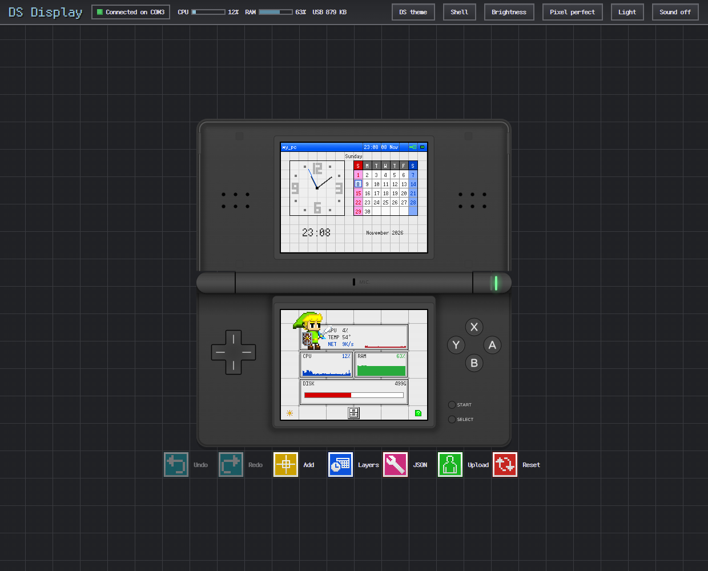
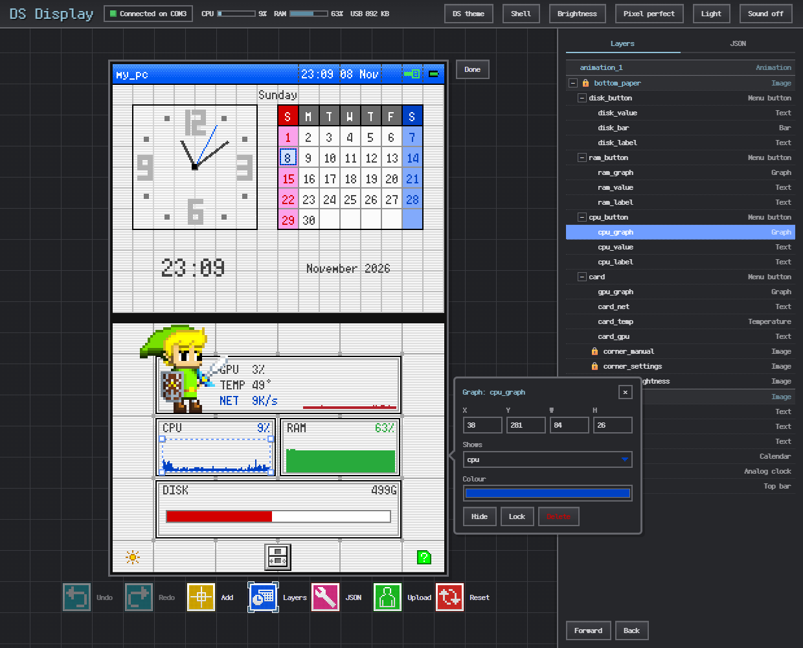
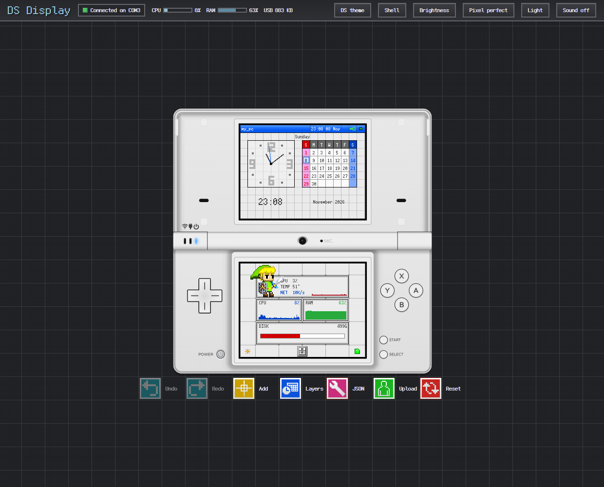
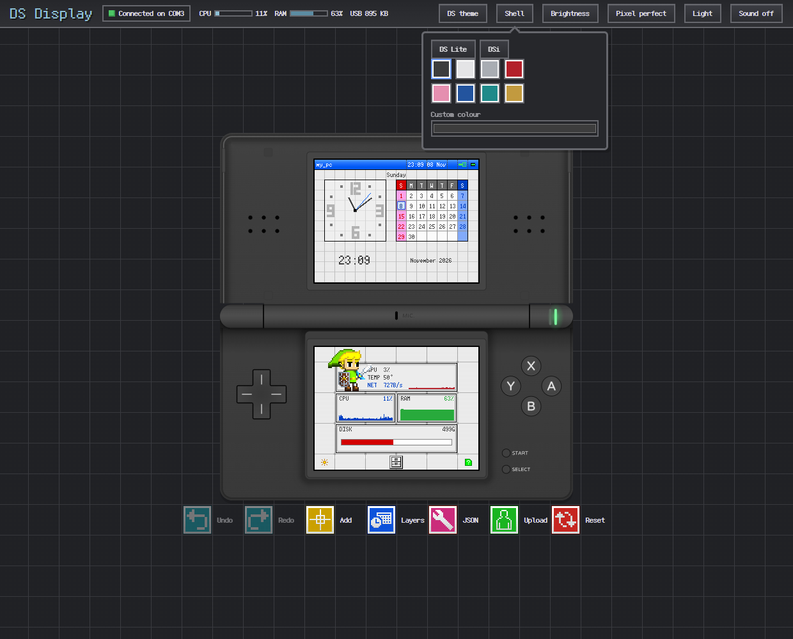
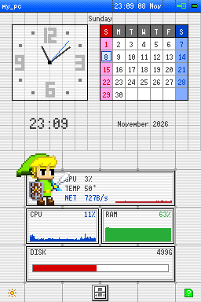

# dspico-usb-display

Turns a DS Lite or DSi with a DSpico flashcart into a USB stats display for the PC: CPU, RAM, GPU,
temperature, disk and network, a clock and calendar, and your own images and GIFs. The roadmap is
in [docs/PLAN.md](docs/PLAN.md).



## What it does

- **Live editor:** a Windows tray app shows the DS as it is right now. Click a screen to edit at
  2× or more, drag widgets, and the DS updates as you go. Widgets snap to edges and each other
  (Alt places freely), and arrow keys nudge them. Layers and JSON open on the right.

  

- **DS Lite or DSi:** the shell is drawn to scale, in any colour, and its buttons click. **Pixel
  perfect** keeps it sharp; **Fill** makes it as big as the window.

   

- **Real DS look:** themes use the classic DS menu's art. GIFs play on the DS itself, with live
  values showing through their transparent parts.

  

- **Keeps itself up to date:** when the app comes with a newer DS build, it pushes it over USB and
  copies it onto the SD card, so you never take the card out.

## Install

Download the files from the latest [release](../../releases):

1. **On the PC:** run `DS-Display-Setup-<version>.exe`. It installs for your user only, with no
   admin rights needed, and sits in the system tray. The editor shows the version next to its name.
2. **On the DS:** copy `usb-display.nds` to the SD card, start it from the DSpico menu, and plug
   the DSpico into the PC.

What changed in each version is in [CHANGELOG.md](CHANGELOG.md).

### Making a release

1. Raise the version in [VERSION](VERSION): the last number for fixes, the middle one for new
   features, and the first for changes that break layouts or themes.
2. Add a section for it at the top of [CHANGELOG.md](CHANGELOG.md), and commit.
3. Run `tools/release --publish`. It builds everything, tags `v<version>`, and publishes the
   installer, `usb-display.nds` and install steps as a GitHub release. `tools/release` alone only
   builds the files, into `release/<version>/`.

The DS app also has a build number of its own, which goes up whenever its code changes. The PC app
uses it to keep the DS up to date.

The rest of this README is for working on the code.

## Layout

| Path | What it is | Who owns it |
|---|---|---|
| `ds/` | DS app (ARM7 + ARM9); see [ds/README.md](ds/README.md) | This repo |
| `platform/` | TinyUSB port for the DSpico, copied from `dspico-usb-examples` so it can be changed; keep `platform/LICENSE.txt` | This repo |
| `tools/` | Host-side scripts | This repo |
| `dspico/firmware`, `dspico/pico-loader`, `dspico/pico-launcher` | DSpico core | Upstream LNH-team until changed (submodule) |
| `libs/libtwl`, `libs/tinyusb` | Libraries | Upstream, pinned (submodule) |

## Setup

```bash
git clone git@github.com:tinkerizer/dspico-usb-display.git && cd dspico-usb-display
git submodule update --init libs/libtwl libs/tinyusb
```

Only init `dspico/*` when working on them. `dspico/firmware` also needs
`git submodule update --init pico-sdk` inside it, and a `roms/default.nds` of your own,
which must never be committed.

## Build

```bash
export DEVKITPRO=/opt/devkitpro DEVKITARM=/opt/devkitpro/devkitARM
export PATH=$DEVKITPRO/tools/bin:$DEVKITARM/bin:$PATH
make -C ds          # produces ds/usb-display.nds
```

## Deploy and debug

Once a build with the dev port is on the DS, everything goes over USB. From WSL:

```bash
make -C ds push      # build, upload, reboot into it, confirm it is running
tools/ds log         # stream DS log output
tools/ds shot        # save both screens to build/screenshot.png
tools/ds ping        # status and counters
tools/ds peek 0x02000000 64
```

`tools/ds` runs under Windows Python, which needs `pyserial`. On the ARM9, log with
`debug_log()` from `ds/arm9/source/debug.h`. Run the host tests with
`python3 -m unittest discover -s tools -p 'test_*.py'`.

## Changing DSpico core code

Upstream repos stay pinned to LNH-team until the first change. Then fork that repo on
GitHub, point the submodule at the fork, and work on a branch:

```bash
git submodule set-url dspico/firmware git@github.com:tinkerizer/dspico-firmware.git
```

Rebase those branches on upstream, and send general-purpose fixes back as pull requests.

## Licence

GPL 3 or later: see [LICENSE](LICENSE). Libraries and fonts from elsewhere keep their own
licences, listed in [THIRD_PARTY.md](THIRD_PARTY.md).
